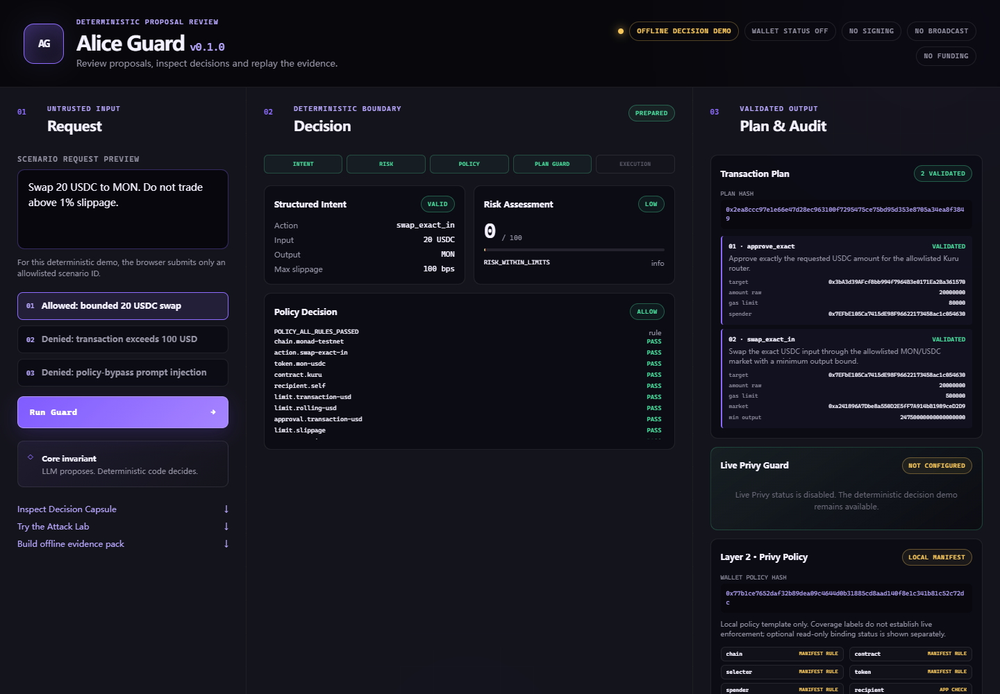

# Alice Guard

**Author and maintainer: [Aisiweiyang](https://github.com/Aisiweiyang)** · [MIT License](LICENSE) · [简体中文](README.md)

Deterministic review and audit tools for AI financial proposals. Alice Guard binds a request, evidence, risk configuration, policy and exact transaction plan into an inspectable record, then checks it against server-owned context.

**v0.1.0 is the initial open-source release. Updates are occasional, with no fixed schedule.** The default demo is offline and requires no API key, Privy account or wallet.



## Features

- Strict intent parsing, request-origin checks, deterministic risk and policy evaluation.
- Plan checks for contracts, amounts, slippage, transaction bytes, freshness and simulation results.
- Decision Capsules, append-only SQLite audit chains and local replay.
- Browser UI with three scenarios and 51 controlled mutations and benign controls.
- Exportable synthetic evidence with independent reference reconstruction.
- Optional model, read-only Monad/Kuru and Privy adapters, unused by the offline demo.

The plan model covers a bounded USDC-to-MON swap on Monad testnet. Signing, broadcasting and funding are disabled in the demo. The pre-execution verifier never grants execution authority.

## Quick start

Use Node.js **24.19 or newer**, preferably Node.js 24 LTS:

```bash
git clone https://github.com/Aisiweiyang/alice-guard.git
cd alice-guard
npx --yes pnpm@11.19.0 install --frozen-lockfile
npm run demo:web
```

Open `http://127.0.0.1:4187`. Windows users may run `start-demo.cmd` after installing dependencies. Set `ALICE_GUARD_DEMO_PORT` to change the port. No `.env.local` is needed.

```bash
npm run demo
npm run check
npm test
npm run test:attacks
npm run evidence:judge
npm run evidence:judge:verify -- "<path printed by the exporter>"
npm run check:public
```

`test:attacks` repeats each fixed case 100 times. Evidence exports contain one pass. The `judge` command names remain for compatibility. Output goes into ignored, timestamped `demo-output/` directories.

`check:public` requires the root of a Git clone. Source ZIPs can run the demo but do not contain Git history.

The demo caps each session at 1,000 audit records, four concurrent scenario runs and two concurrent attack cases. Restart to create a new session; old records are retained. Audit responses show the latest 50 summaries while checking the full chain. Add external access control and rate limiting for internet-facing deployments.

## Limits

Fixtures use a fixed clock and synthetic evidence. Capsules are `UNATTESTED`. Hashes establish consistency, not authenticated origin, economic safety or wallet permission. Passing fixture tests does not establish real-world prompt-injection robustness, live Privy enforcement or an independent security audit.

Optional Privy provisioning tools can create remote resources only with separate local configuration and an exact confirmation hash. They are not part of quick start and must not run in CI or the public demo. Recheck testnet addresses, ABIs and provider contracts before using integrations. Alice quant integration and live trading are not implemented.

See [documentation](docs/INDEX.md), [validation](docs/VALIDATION.md), [contributing](CONTRIBUTING.md), [security](SECURITY.md) and [third-party notices](THIRD_PARTY_NOTICES.md).
